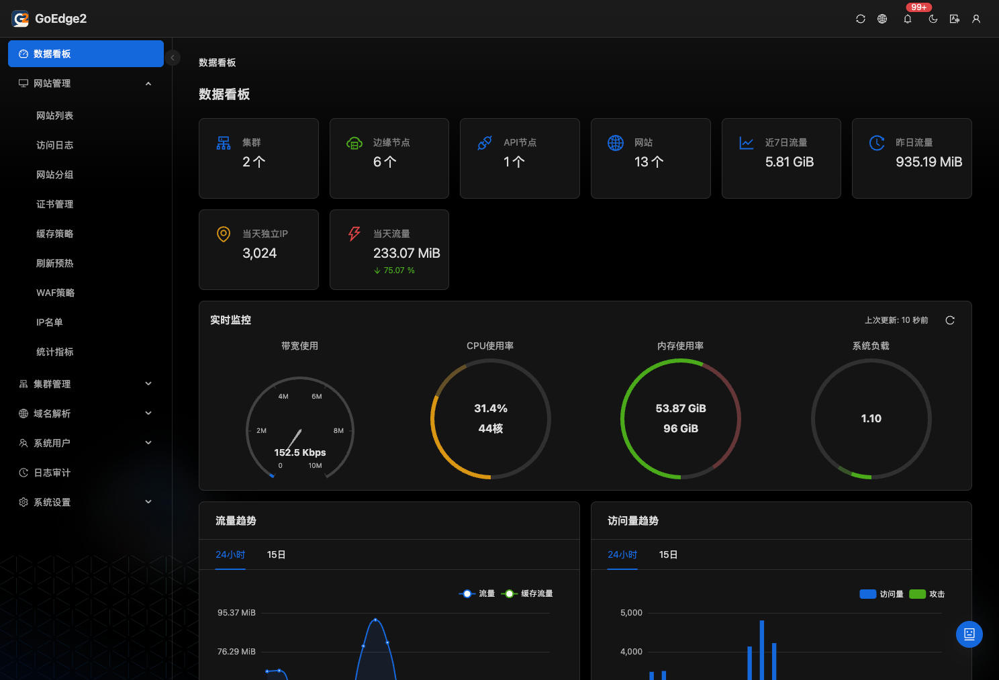
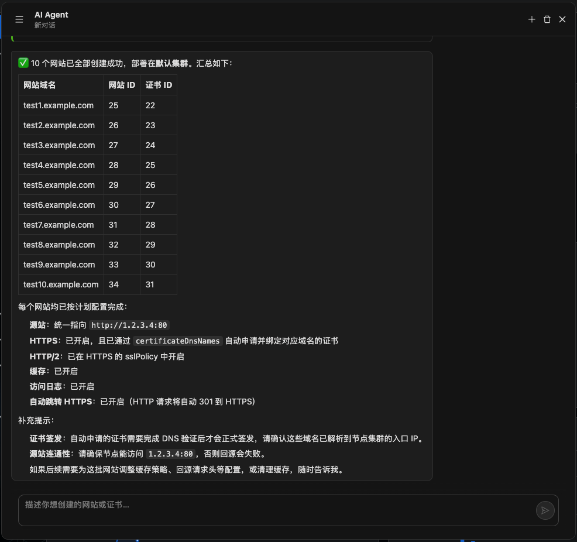

#  GoEdge2

新一代高性能、易用的自托管 CDN 系统。

## 什么是 GoEdge2？

GoEdge2 是在 GoEdge 基础上持续发展的 CDN 与边缘服务管理系统，后端使用 Go 开发，管理面板基于 React 和 Umi 构建。你可以将自己的服务器组成边缘节点集群，通过统一的 Web 面板管理网站、缓存、证书、安全策略和运行状态，搭建由自己掌控的内容分发网络。

从网站反向代理、静态资源加速，到多节点管理和日常运维，GoEdge2 将流量接入、内容缓存、安全防护与监控分析整合在同一套系统中。同时，内置的 AI Agent 支持通过自然语言查询运行状态、分析统计数据，并在确认后执行配置变更等操作，也可通过 Telegram Bot 进行交互。

GoEdge2 兼顾新部署与已有 GoEdge 环境，支持与 GoEdge 1.3.9 共存，为逐步迁移提供过渡方式。

## 主要特性

- **网站加速**：支持反向代理、内存与磁盘缓存、缓存刷新和预热，减少重复回源。
- **集中管理**：统一管理边缘节点、集群和网站配置，查看节点状态与运行指标。
- **安全防护**：内置 WAF，支持访问控制与 CC 防护策略。
- **证书自动化**：支持通过 ACME 自动申请证书、配置自动续期，并集中管理证书。
- **协议支持**：支持 HTTP/2、HTTP/3 和 WebSocket；HTTP 与 HTTPS 可共享监听端口，减少端口配置冲突。
- **智能运维**：内置 AI Agent，支持状态查询、统计分析和运维操作，并可接入 Telegram Bot。
- **日志与统计**：提供访问日志、操作审计和流量统计，便于排查问题、追踪变更。
- **IP 数据**：内置高精度 IP 库，同时支持 IPv4 和 IPv6。
- **多数据库支持**：支持 MySQL、PostgreSQL 和 SQLite，可按部署需求选择。
- **旧版兼容**：兼容 GoEdge 1.3.9，支持长期共存与逐步迁移。

## UI 预览

### 首页看板



### AI Agent



## 安装

### 环境要求

- 在线安装脚本支持 Linux 和 macOS，CPU 架构支持 AMD64（x86_64）和 ARM64。
- Linux 需要 root 权限，以及 glibc 2.17 或更高版本。
- 数据库可选择 MySQL、PostgreSQL 或 SQLite；使用 SQLite 时无需单独部署数据库服务。

### 在线安装

Linux 上执行：

```bash
curl -fsSL https://raw.githubusercontent.com/goedge2/goedge2/main/install.sh | sudo bash
```

默认安装父目录为 `/usr/local/goedge2`，API 服务的实际目录为 `/usr/local/goedge2/goedge2-api`。自定义父目录可使用 `--dir` 参数：

```bash
curl -fsSL https://raw.githubusercontent.com/goedge2/goedge2/main/install.sh | sudo bash -s -- --dir /opt/goedge2
```

上述命令会将 API 服务安装到 `/opt/goedge2/goedge2-api`。

macOS 可安装到当前用户有写入权限的目录：

```bash
curl -fsSL https://raw.githubusercontent.com/goedge2/goedge2/main/install.sh | bash -s -- --dir "$HOME/goedge2"
```

macOS 安装前需准备 `curl`、`unzip`、`jq` 以及 `sha256sum` 或 `shasum`。安装完成后，按终端提示手动启动服务：

```bash
cd "$HOME/goedge2/goedge2-api"
./bin/goedge2-api start
```

### 首次使用

1. 按安装向导设置 API 节点地址和数据库连接，初始化后会创建默认管理员 `admin`，密码随机创建，请根据引导注意保存。
2. 使用初始化结果中显示的访问地址打开管理面板。首次创建管理员时，终端会显示用户名和密码；已有管理员的凭据保持不变。
3. 在面板中创建或选择集群，添加并安装边缘节点。
4. 添加网站，配置域名、源站、缓存和证书，并将业务域名解析到相应的边缘节点。

节点需要能够访问所配置的 API 地址；管理面板和网站所使用的端口也需要在防火墙及云安全组中放行。

Linux 安装脚本会注册并启动 `goedge2-api` 服务。常用管理命令：

```bash
sudo systemctl status goedge2-api
sudo systemctl restart goedge2-api
sudo journalctl -u goedge2-api -n 100 --no-pager
```

数据库连接与节点身份保存在 API 安装目录下的 `configs/goedge2.yaml` 中。

## 与 GoEdge 1.3.9 共存

安装向导在检测到可共存的旧版 GoEdge 环境时，会询问是否使用原有配置。选择共存后，GoEdge2 使用旧版数据库，并通过独立的程序、服务和配置目录运行，便于逐步接入新版本。

共存模式复用已有数据库，不会将旧程序、旧服务或旧安装目录自动迁移为 GoEdge2。部署前请备份数据库和配置，并为新 API 服务选择可用端口。

## 反馈与贡献

欢迎通过 Issue 反馈问题、提出建议，也欢迎提交 Pull Request。

反馈问题时，请附上版本、操作系统与 CPU 架构、数据库类型、复现步骤和相关日志；界面问题可附截图。提交前请隐藏密码、私钥、令牌及其他敏感信息。

## 开源许可与致谢

GoEdge2 基于 GoEdge 项目发展，感谢原作者及社区贡献者。
